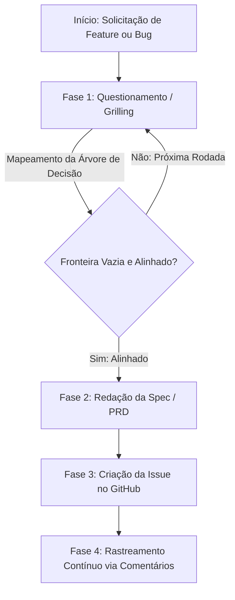

# Skill: Specs (Especificações de Features e Bugs)

Esta skill guia o agente na elaboração de especificações completas de engenharia no padrão **PRD (Product Requirement Document)** para novas funcionalidades ou **Bug Spec** para correção de defeitos complexos.

Baseada na metodologia do repositório [mattpocock/skills](https://github.com/mattpocock/skills) (`to-spec`, `grilling` e `diagnosing-bugs`), ela garante que nenhuma decisão seja assumida silenciosamente, que a arquitetura respeite as boas práticas de Ruby on Rails e que todo o histórico seja sincronizado com o GitHub Issues.

---

## 🔄 Fluxo de Execução em 4 Fases



---

## ❓ Fase 1: Questionamento Rigoroso (Grill-Me Protocol)

Antes de escrever a spec, **nunca faça suposições**. Realize uma entrevista estruturada em rodadas:

1. **Mapeie a Árvore de Decisão:**
   - Cada decisão inicial gera ramificações (ex: "Criar novo modelo ou estender existente?" -> "Como será o relacionamento com User?" -> "Haverá soft-delete?").
2. **Trabalhe na Fronteira (The Frontier):**
   - Apenas faça perguntas cujos pré-requisitos já estejam respondidos.
   - Apresente todas as perguntas da fronteira atual em uma única rodada estruturada.
3. **Fatos são trabalho do Agente, não do Usuário:**
   - Se uma pergunta requer verificar o schema do banco, rotas ou arquivos do projeto, **leia os arquivos você mesmo**. Nunca pergunte ao usuário o que pode ser consultado no código.
4. **Formato Obrigatório de Cada Pergunta:**
   ```markdown
   ❓ **Q1** - **<Título da Decisão>**: <Contexto, trade-offs e opções>
   ➡️ **Opção Recomendada:** <Sua recomendação técnica fundamentada>
   ```
   *(Formule a pergunta de modo que um simples "Sim" ou "Aprovado" aprove sua recomendação).*
5. **Critério de Conclusão da Fase 1:** A fronteira está vazia quando todos os pontos arquiteturais, casos de borda e regras de negócio foram definidos e o usuário confirmou o entendimento.

---

## 📝 Fase 2: Redação da Especificação Padronizada

Dependendo do tipo de demanda, selecione o template correspondente:

### A. Para Novas Funcionalidades (Features) -> Padrão PRD
Utilize o template [templates/feature-prd.md](./templates/feature-prd.md):
- **Declaração do Problema & Solução** do ponto de vista do usuário final.
- **Lista Extensa e Numerada de Histórias de Usuário**:
  `Como um <ator>, eu quero <funcionalidade>, para que <benefício>`.
- **Critérios de Aceite em formato Gherkin** (`Dado / Quando / Então`).
- **Decisões Técnicas alinhadas a Rails 8:**
  - Migrações seguras (índices, null constraints, foreign keys).
  - Padrão de Controllers magros e Services/Query Objects coesos.
  - Definição do ponto de corte para testes (**Highest Seam**).
  - Validações de segurança (Strong Parameters, proteção contra N+1 com `strict_loading`/`includes`).
- **Fora de Escopo (Out of Scope)** explícito.

### B. Para Defeitos e Erros (Bugs) -> Bug Spec
Utilize o template [templates/bug-spec.md](./templates/bug-spec.md):
- **Sintoma Exato & Comportamento Esperado**.
- **Passo a Passo de Reprodução Mínima**.
- **Loop de Feedback Automatizado (Tight Red-Capable Loop):** Comando único determinístico que falha agora e passará após o fix.
- **3 a 5 Hipóteses Falsificáveis** ranqueadas antes de alterar código.
- **Identificação da Costura (Seam) Correta** para o teste de regressão.

Salve o documento gerado em: `docs/specs/<tipo>-<slug>.md`.

---

## 🐙 Fase 3: Abertura da Issue no GitHub

Toda spec gerada **DEVE** ser sincronizada no GitHub abrindo uma Issue formal:

Execute o helper [scripts/github-issue-sync.sh](./scripts/github-issue-sync.sh):

```bash
.agents/skills/specs/scripts/github-issue-sync.sh create \
  "[PRD] Título da Feature ou [BUG] Título do Defeito" \
  "docs/specs/<arquivo-da-spec>.md" \
  "spec,ready-for-agent"
```

1. Capture a URL e o número da Issue retornada (ex: `#12`).
2. Atualize o cabeçalho de Metadata do arquivo `docs/specs/<arquivo-da-spec>.md` com o link oficial da Issue criada.
3. Apresente ao usuário o link clicável da Issue no GitHub.

---

## 💬 Fase 4: Registro Contínuo de Cada Interação

**Regra Absoluta:** Toda interação subsequente relevante DEVE ser comentada na Issue do GitHub:

- Rodadas de perguntas e respostas adicionais.
- Mudanças ou refações em decisões de implementação.
- Confirmação de hipótese de bug ou resultado de testes.
- Status de início, pull request vinculado ou conclusão da spec.

Execute o comando de comentário:
```bash
.agents/skills/specs/scripts/github-issue-sync.sh comment \
  "<numero-da-issue>" \
  "### 🔄 Atualização de Alinhamento\n\n<detalhes da decisão ou interação tomada nesta etapa>"
```

Isso garante auditabilidade completa e histórico integrado diretamente no repositório.
