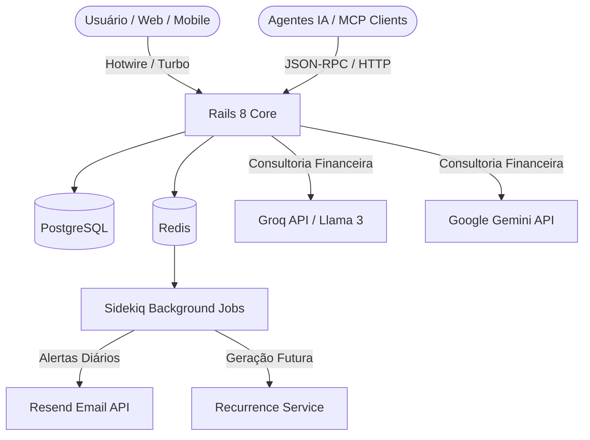

<div align="center">

# 💰 Controle Financeiro

**Gestão financeira pessoal e empresarial moderna, inteligente e de código aberto.**  
Construído com **Ruby on Rails 8**, **Tailwind CSS**, **PostgreSQL**, **Sidekiq** e **Inteligência Artificial (Groq / Gemini)**.

---

[](https://www.ruby-lang.org/)
[](https://rubyonrails.org/)
[](https://www.postgresql.org/)
[](https://tailwindcss.com/)
[](https://www.docker.com/)
[](LICENSE)

[Funcionalidades](#-funcionalidades-principais) •
[Início Rápido](#-início-rápido-com-docker) •
[Instalação Local](#-instalação-local-sem-docker) •
[Variáveis de Ambiente](#-variáveis-de-ambiente) •
[Documentação](#-documentação-completa) •
[Licença](#-licença)

</div>

---

## 💡 Sobre o Projeto

O **Controle Financeiro** é uma plataforma completa e moderna para quem busca controle rigoroso sobre suas finanças pessoais ou pequenos negócios, sem depender de planilhas complexas ou plataformas pagas que retêm seus dados.

Diferente de sistemas tradicionais, a plataforma combina organização de **múltiplas contas**, **faturas de cartão com compras parceladas** e **despesas recorrentes** com o poder de **LLMs de última geração (Groq e Google Gemini)** e um **servidor MCP nativo**, permitindo auditoria e consultoria preditiva sobre suas despesas.

---

## 🌟 Funcionalidades Principais

### 📊 1. Dashboard e Gestão Consolidada
- **Visão 360°:** Saldo consolidado, receitas x despesas do mês e saldo previsto para os próximos períodos.
- **Gráficos Interativos:** Distribuição de despesas por categoria e evolução temporal do patrimônio.
- **Múltiplas Contas Bancárias:** Acompanhe saldos individuais e movimentações de contas correntes, poupanças e investimentos.
- **Transferências Pareadas:** Transações entre contas do mesmo usuário com garantia de integridade e idempotência.

### 💳 2. Cartões de Crédito e Faturas Parceladas
- **Controle por Cartão:** Dias de fechamento e vencimento, limites disponíveis e limites comprometidos.
- **Parcelamentos Automáticos:** Lançamento de compras parceladas com geração e distribuição matemática de parcelas nos meses subsequentes.
- **Faturas Mensais Dinâmicas:** Abertura, fechamento e quitação de faturas com reconciliação imediata na conta bancária de pagamento.

### 🔁 3. Recorrências & Projeções de Fluxo de Caixa
- **Agendamento Flexível:** Despesas e receitas diárias, semanais, quinzenais, mensais, bimestrais ou anuais.
- **Estratégias de Edição:** Escolha entre aplicar reajustes em *todas as parcelas futuras* ou *a partir de uma ocorrência específica*.
- **Geração Automatizada:** Jobs em segundo plano que mantêm sua linha do tempo financeira sempre projetada.

### 🤖 4. Consultoria Financeira com IA
- **Análise Preditiva de Gastos:** Diagnóstico automatizado de padrões de consumo, detecção de gastos invisíveis e oportunidades de economia.
- **Multi-Provedor:** Suporte flexível a **Groq (Llama 3.3 70B)** e **Google Gemini (Gemini 2.5 Flash)**.
- **Chaves Personalizadas:** Cada usuário pode optar por usar a chave global do sistema ou cadastrar sua própria chave de API.

### 📥 5. Importação Inteligente de Extratos
- **Suporte a CSV e PDF:** Envie extratos bancários e visualize um preview estruturado antes de confirmar.
- **Auto-categorização:** Motor de inferência baseado em palavras-chave (`CategoryKeyword`) que classifica lançamentos automaticamente.

### 📧 6. Alertas e Notificações Automatizadas
- **Alertas de Vencimento:** Notificações diárias estruturadas via **Resend** alertando sobre contas vencendo em 5 dias, 3 dias, hoje ou já em atraso.

### 🔌 7. Servidor MCP (Model Context Protocol) Nativo
- **Integração com Assistentes de IA:** Conecte o Claude Desktop, Cursor, Antigravity ou scripts autônomos para interagir com suas finanças via linguagem natural com autenticação por Bearer Token.

---

## 🏛️ Arquitetura & Fluxo de Dados



---

## 🚀 Início Rápido com Docker

A maneira mais rápida de rodar toda a aplicação (Rails + PostgreSQL + Redis + Sidekiq) é utilizando o Docker Compose:

### 1. Clonar o projeto
```bash
git clone https://github.com/seu-usuario/controle-financeiro.git
cd controle-financeiro
```

### 2. Configurar o arquivo `.env`
```bash
cp .env.example .env
```
*(As configurações padrão do `.env.example` já estão prontas para o ambiente Docker).*

### 3. Subir os containers
```bash
docker compose up -d --build
```

### 4. Inicializar o banco de dados
```bash
# Executa as migrações e popula as categorias padrão
docker compose exec web bundle exec rails db:prepare
docker compose exec web bundle exec rails db:seed
```

Pronto! Acesse:
- 🌐 **Aplicação Web:** [http://localhost:3000](http://localhost:3000)
- ⚙️ **Painel do Sidekiq:** [http://localhost:3000/sidekiq](http://localhost:3000/sidekiq)

---

## 💻 Instalação Local (Sem Docker)

Se preferir rodar nativamente na sua máquina:

### Pré-requisitos
- **Ruby:** `3.4.1`
- **PostgreSQL:** `14+`
- **Redis:** `7+`
- **Node.js:** `v20+` e **npm** `10+`

### Passo a passo
```bash
# 1. Instalar dependências
bundle install
npm install

# 2. Configurar variáveis de ambiente
cp .env.example .env

# 3. Preparar banco de dados
bundle exec rails db:create db:migrate db:seed

# 4. Iniciar servidores de desenvolvimento (Rails + Tailwind + Sidekiq)
./bin/dev
```

Para mais detalhes, leia o [Guia Detalhado de Instalação](docs/instalacao.md).

---

## ⚙️ Variáveis de Ambiente

Todas as configurações são gerenciadas através de variáveis de ambiente. Veja as principais:

| Variável | Obrigatória? | Descrição | Valor Padrão |
| :--- | :---: | :--- | :--- |
| `SECRET_KEY_BASE` | Sim (Prod) | Chave criptográfica do Rails (`rails secret`) | - |
| `DATABASE_HOST` | Não | Endereço do host do PostgreSQL | `localhost` (ou `db`) |
| `DATABASE_USER` | Não | Usuário do PostgreSQL | `postgres` |
| `DATABASE_PASSWORD` | Não | Senha do PostgreSQL | `postgres` |
| `DATABASE_NAME` | Não | Nome do banco de dados | `finances_development` |
| `REDIS_URL` | Não | URL de conexão do Redis | `redis://localhost:6379/0` |
| `SIDEKIQ_USERNAME` | Não | Usuário para o painel `/sidekiq` | `admin` |
| `SIDEKIQ_PASSWORD` | Não | Senha para o painel `/sidekiq` | `sidekiq` (dev) |
| `RESEND_API_KEY` | Não | Chave de envio da API Resend | - |
| `MAILER_DEFAULT_FROM` | Não | E-mail de remetente dos alertas | `noreply@example.com` |
| `AI_PROVIDER` | Não | Motor de IA padrão (`groq` ou `gemini`) | `groq` |
| `GROQ_API_KEY` | Não | Chave da API Groq | - |
| `GEMINI_API_KEY` | Não | Chave da API Google Gemini | - |
| `MCP_AUTH_TOKEN` | Não | Token de autenticação Bearer para o `/mcp` | - |

Consulte o arquivo [.env.example](.env.example) para ver todas as opções comentadas.

---

## 📁 Estrutura do Repositório

```text
controle-financeiro/
├── app/
│   ├── controllers/         # Controladores da aplicação e endpoint MCP
│   ├── javascript/          # Controladores Stimulus e gráficos Chart.js
│   ├── jobs/                # Jobs assíncronos (notificações, geração de recorrências)
│   ├── mailers/             # Templates de e-mails transacionais (Resend)
│   ├── models/              # Modelos de dados e validações de negócio
│   ├── services/            # Serviços de IA (Groq/Gemini), faturas, extratos e MCP
│   └── views/               # Views com Tailwind CSS e componentes Hotwire/Turbo
├── config/                  # Configurações do Rails, rotas, sidekiq e banco
├── db/                      # Migrations, schemas e seeds
├── docs/                    # Documentação técnica e manuais de uso
│   ├── funcionalidades.md   # Módulos, arquitetura e diagrama ER
│   ├── instalacao.md        # Guia completo de instalação Docker e nativa
│   ├── mcp.md               # Integração do servidor Model Context Protocol
│   ├── notificacoes-email.md# Configuração de e-mails com Resend
│   └── recorrencias.md      # Lógica e regras de parcelamentos/recorrências
├── docker-compose.yml       # Orquestração local de desenvolvimento
├── Dockerfile               # Imagem Docker otimizada multi-stage
└── mcp/                     # Implementação do servidor MCP stdio e exemplos
```

---

## 📚 Documentação Completa

Acesse os guias complementares para se aprofundar em cada módulo:

- 📖 [Guia Completo de Instalação](docs/instalacao.md)
- 🏗️ [Arquitetura de Dados e Funcionalidades](docs/funcionalidades.md)
- 🔁 [Como Funcionam as Recorrências](docs/recorrencias.md)
- 📧 [Alertas de Vencimento por E-mail](docs/notificacoes-email.md)
- 🔌 [Manual do Servidor MCP](docs/mcp.md)

---

## 🧪 Testes e Qualidade de Código

O projeto conta com suíte de testes unitários e de integração, além de linters de segurança:

```bash
# Executar a suíte de testes
bundle exec rails test

# Análise estática de vulnerabilidades com Brakeman
bundle exec brakeman --no-pager

# Auditoria de dependências com Bundler Audit
bundle exec bundler-audit

# Verificação de padrões de código com RuboCop
bundle exec rubocop
```

---

## 🤝 Contribuições

Contribuições são muito bem-vindas! Se você deseja colaborar com novas funcionalidades, melhorias na interface ou correções de bugs:

1. Faça um Fork do projeto
2. Crie uma branch para sua funcionalidade (`git checkout -b feature/minha-melhoria`)
3. Faça commit das suas alterações (`git commit -m 'feat: adiciona nova funcionalidade'`)
4. Faça push para a branch (`git push origin feature/minha-melhoria`)
5. Abra um **Pull Request**

---

## 📄 Licença

Este projeto é disponibilizado sob a licença [MIT](LICENSE). Sinta-se livre para usar, modificar e distribuir conforme necessário.
