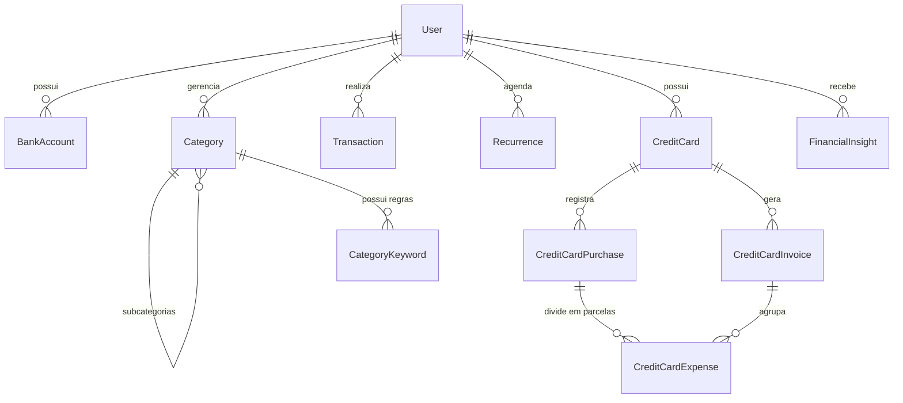

# 📦 Arquitetura e Funcionalidades

O **Controle Financeiro** é uma aplicação completa de gestão financeira pessoal e empresarial leve desenvolvida em **Ruby on Rails 8**.

---

## 🏗️ Modelagem e Entidades Principais

### 1. Autenticação e Perfis (`User`)
- Gerenciado via **Devise**.
- Suporte a chaves de API personalizadas por usuário para LLMs (**Groq** e **Google Gemini**).
- Permite que cada usuário utilize tanto a chave global do sistema quanto sua própria chave individual.

### 2. Contas Bancárias (`BankAccount`)
- Saldo inicial e cálculo automático de saldo consolidado.
- Agrupamento de transações e extrato por conta.

### 3. Categorização Inteligente (`Category` & `CategoryKeyword`)
- Suporte a hierarquia de categorias (categorias pai e subcategorias).
- Palavras-chave associadas a cada categoria para auto-categorização durante importações de extratos bancários.

### 4. Transações (`Transaction`)
- Movimentações de **Entrada** (receitas) e **Saída** (despesas).
- Controle de status: pago / pendente / vencido.
- Suporte a **Transferências entre contas** com transações pareadas e chave de idempotência.

### 5. Cartões de Crédito e Faturas
- **CreditCard:** Limite total, dia de fechamento e dia de vencimento.
- **CreditCardPurchase:** Registro de compras à vista ou parceladas.
- **CreditCardExpense:** Cada parcela individual com seu mês de competência e valor.
- **CreditCardInvoice:** Faturas geradas automaticamente contendo as parcelas do período correspondente.

### 6. Movimentações Recorrentes (`Recurrence`)
- Frequências: diária, semanal, quinzenal, mensal, bimestral, trimestral, semestral e anual.
- Geração automática de transações futuras com janela configurável.
- Edição flexível (atualizar todas as futuras ou a partir de uma data específica).

### 7. Consultoria Financeira com IA (`FinancialInsight`)
- Análise automatizada de receitas, despesas, parcelamentos e fluxo de caixa futuro.
- Geração de sugestões práticas de redução de custos, renegociação de dívidas e projeções financeiras.
- Suporte a múltiplos provedores de IA: **Groq** (modelos Llama 3) e **Google Gemini**.

### 8. Importação de Extratos Bancários (`TransactionImport`)
- Suporte à importação de arquivos bancários em **CSV** e **PDF**.
- De/para inteligente baseado no histórico e regras de palavras-chave.
- Tela de pré-visualização antes da efetivação no banco de dados.

### 9. Servidor MCP (`Model Context Protocol`)
- Integração nativa com assistentes de IA (Claude Desktop, Cursor, Antigravity, etc.) via protocolo JSON-RPC sobre HTTP ou Stdio.
